#  Galaxy Visualizations

This repository contains visualization plugins built with [Galaxy Charts](https://charts.galaxyproject.org) for the [Galaxy Project](https://galaxyproject.org/).

Galaxy provides an extensible visualization system for exploring, interpreting, and presenting scientific data.

**Galaxy Charts** provides the shared framework and runtime for building visualizations, while **galaxy-visualizations** contains the visualizations built with it.

Each visualization is a self-contained plugin that integrates with Galaxy datasets and provides its own interactive visualization capabilities.

## Adding Visualizations

New visualizations can be added using Galaxy Charts and contributed to this repository.

Galaxy Charts supports plain JavaScript, Vue, React, and other frameworks, with optional components for building configuration interfaces.

For development guides, plugin configuration, and runtime APIs, see the [Galaxy Charts documentation](https://charts.galaxyproject.org).

Contributions of new visualizations, improvements, and bug fixes are welcome.

## Available Visualizations (57)

| Logo                                                                    | Name                                          | Description                                                                         | Package                                                                                                                                                                                                     |
| ----------------------------------------------------------------------- | --------------------------------------------- | ----------------------------------------------------------------------------------- | ----------------------------------------------------------------------------------------------------------------------------------------------------------------------------------------------------------- |
|              | AI Research Assistant                         | powered by Olit                                                                     |                                                  |
|            | Bar, Line and Scatter                         | Basic Diagrams from http://plotly.com                                               |                                          |
|        | Box Plot                                      | Box Plot from http://plotly.com                                                     |                          |
| 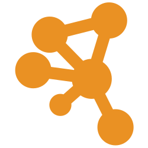        | Cytoscape                                     | Graph viewer from http://js.cytoscape.org                                           |                              |
|         | Editor                                        | Manually edit text content                                                          |                              |
|             | Embedding Atlas                               | Interactive embedding with clustering and search                                    |                                              |
|         | FITS Graph                                    | Displays FITS Tables                                                                |                              |
| 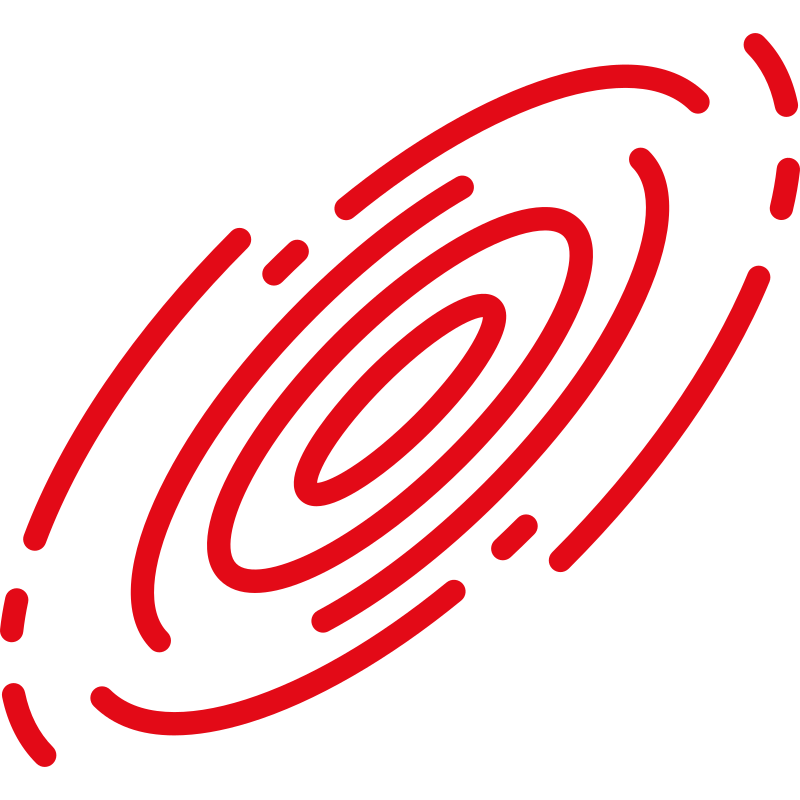           | FITS Image Viewer                             | Aladin Astronomical Images                                                          |                                          |
|             | H5Web                                         | HDF5 data visualization and exploration                                             |                                              |
| 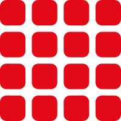          | Heatmap                                       | Renders a heatmap from matrix data provided in 3-column format (x, y, observation). |                                      |
|    | Heatmap Matrix                                | Renders a heatmap from a CSV matrix with first row and column as labels             |          |
|  | Histogram                                     | based on Plotly                                                                     |  |
|          | HIV-TRACE Viewer                              | Browse Transmission Clustering results                                              |                                  |
|       | HyPhy Vision                                  | Interactive HyPhy Viewer                                                            |                      |
|     | Image Annotate                                | Display and Annotate Images                                                         |              |
|               | Integrative Genomics Viewer                   | Explore Genomic Data                                                                |                                                      |
|        | JSON/YAML Viewer                              | Interactive viewer for JSON, YAML, and JSON-LD data                                 |                          |
|       | JupyterLite                                   | Pyodide-based Jupyter Notebooks                                                     |                      |
|             | Katex                                         | TeX math equation rendering                                                         |                                              |
|            | Kepler.gl                                     | Geospatial analysis tool for large-scale data sets                                  |                                          |
|         | LocusZoom                                     | Genome-Wide Association Study Plot                                                  |                              |
|          | Markdown Viewer                               | Read Markdown documents as formatted text                                           |                                  |
|              | Media Player                                  | Audio and Video Player                                                              |                                                  |
| 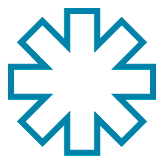          | Molstar Viewer                                | Complex Biomolecular Structures                                                     |                                      |
| 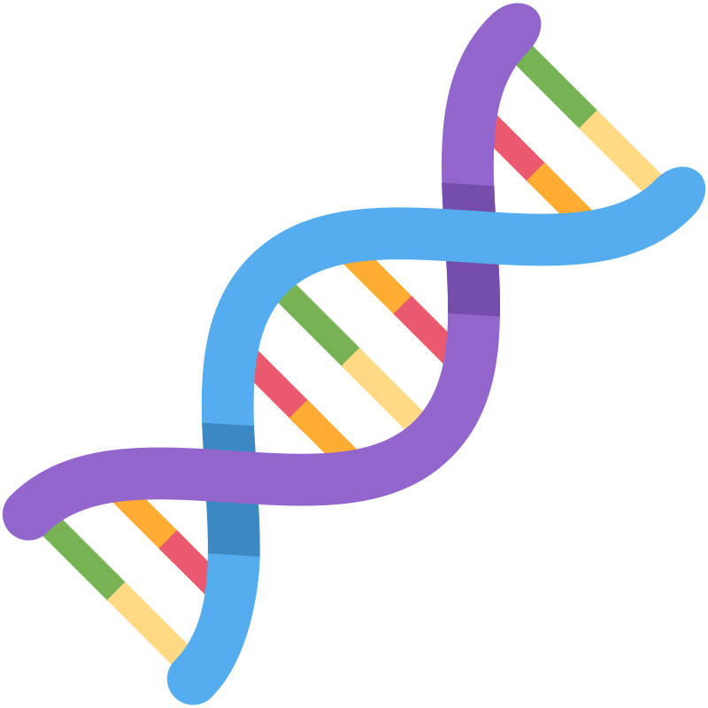        | Multiple Sequence Alignment                   | Large-scale Sequence Alignment Browser                                              |                              |
| 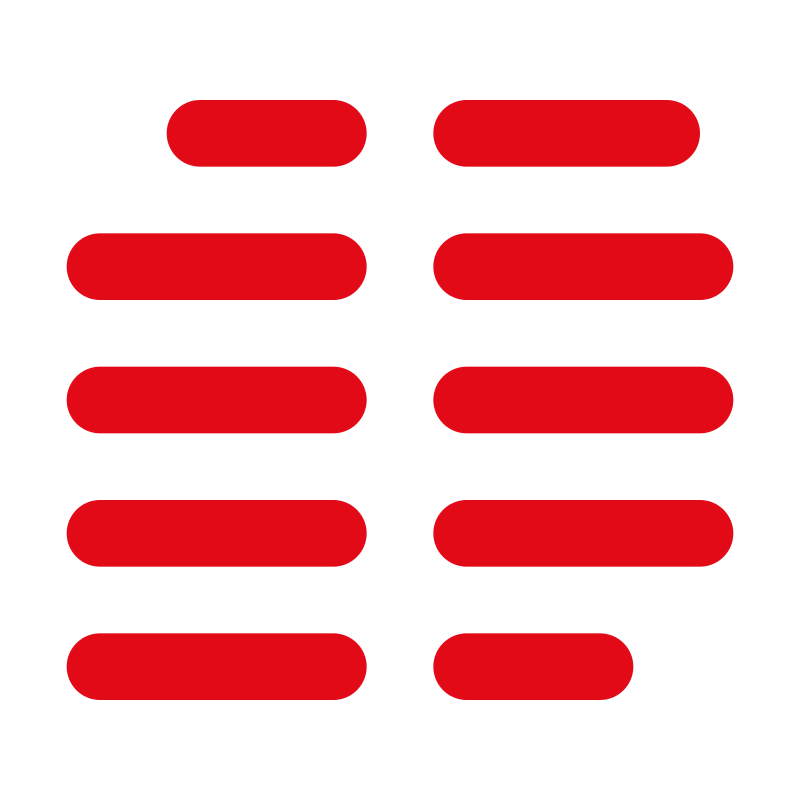  | Multiple Sequence Alignment and Sequence Logo | Advanced Multiple Sequence Alignment Viewer                                         |      |
| 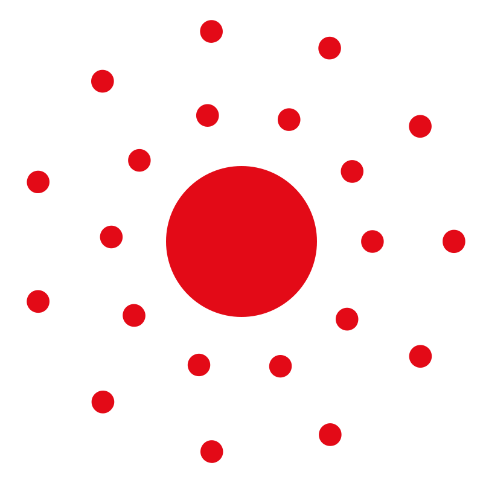           | MVP Application                               | Mass Spectrometry                                                                   |                                          |
|               | NGL Viewer                                    | Display Molecular Structures of Proteins, DNA and more                              |                                                      |
|            | Niivue                                        | Interactive viewer for medical and neuroimaging data                                |                                          |
|              | Nora                                          | Medical Images and Annotations                                                      |                                                  |
|        | OpenLayers map                                | Display Geospatial Data on a Map                                                    |                          |
| 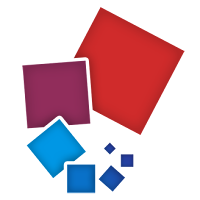    | OpenSeadragon                                 | High-resolution Zoomable Images                                                     |              |
| 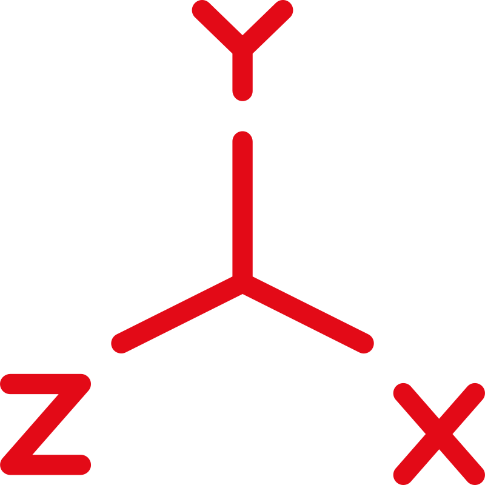              | PCA 3D Plot                                   | Principle Component Analysis                                                        |                                                      |
|               | PDF Viewer                                    | Read PDF documents page by page                                                     |                                                      |
| 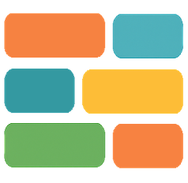         | Phylogenetic Aequatus                         | Gene Structure and Homology                                                         |                                  |
| 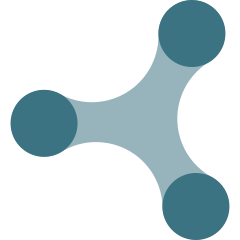      | Phylogenetic Tree                             | Phylogenetic Tree Browser                                                           |                      |
| 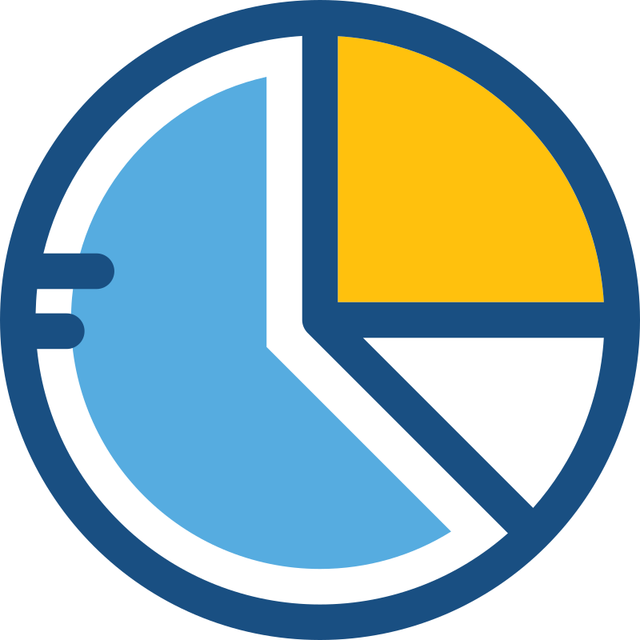       | Pie Chart                                     | Pie Chart from http://plotly.com                                                    |                          |
|           | Rerun.io                                      | Spatial and Embodied AI                                                             |                                      |
|      | RMSX Flipbook                                 | Renders RMSX Flipbook Manifests                                                     |                  |
| 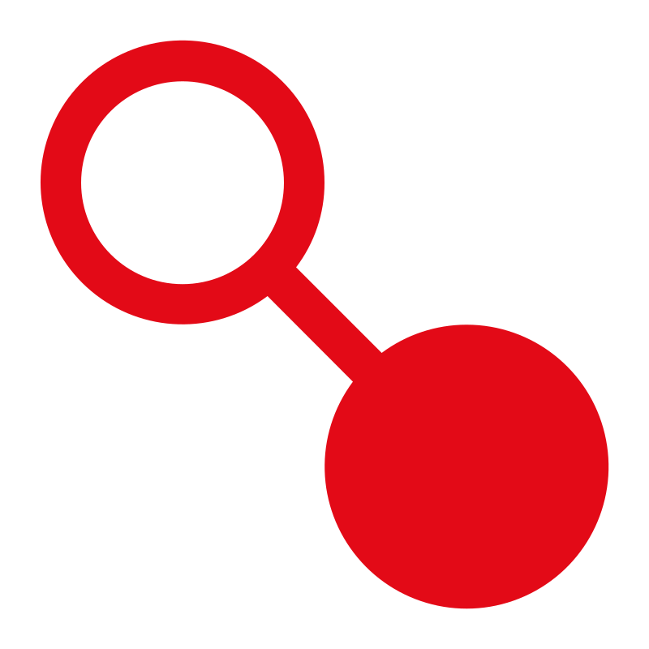         | RNA ChiRAViz                                  | ChiRA tool for chimeric read data                                                   |                                  |
| 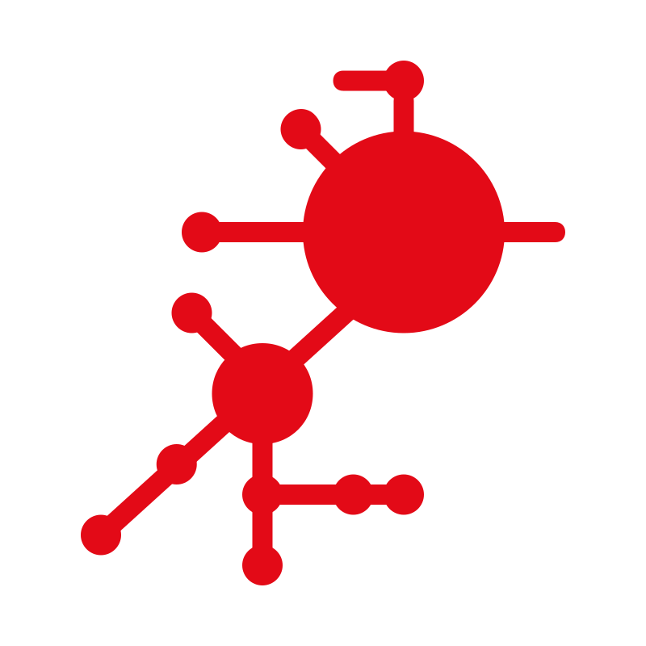          | RNA Structure Viewer                          | 2D-Structures from Dot-Bracket Notation                                             |                                      |
|           | RustGIS                                       | Explore geographic data and LAS/LAZ point clouds                                    |                                      |
| 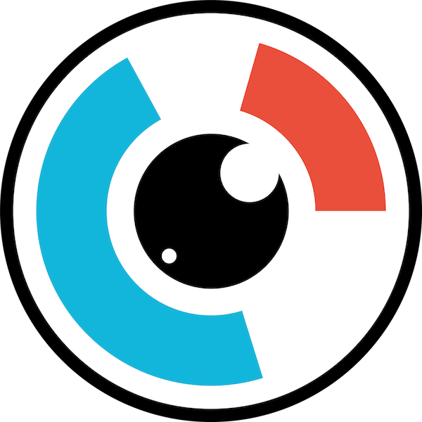           | Sequence Viewer                               | Visualize DNA, RNA, and protein sequences using SeqViz                              |                                          |
|      | SmilesDrawer                                  | Visualize molecular structures from SMILES notation                                 |                  |
|    | Surface Plot                                  | Surface Plot from http://plotly.com                                                 |          |
|         | Tabulator                                     | Table Viewer                                                                        |                              |
|        | Tiff Viewer                                   | Tiff Image Viewer                                                                   |                          |
| 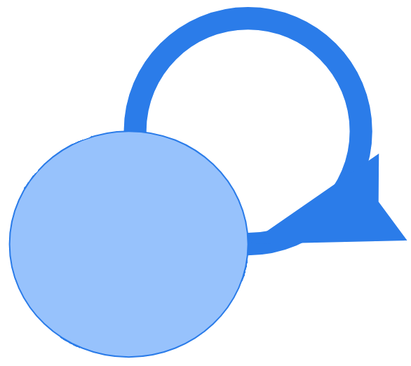         | Transition System                             | Interactive Flow Graph Diagram                                                      |                                  |
|           | Unipept Taxonomy Viewer                       | Interactive Tree, Sunburst and Map Diagrams                                         |                                      |
|             | vaRRI                                         | Visual annotation of RNA-RNA interactions                                           |                                              |
|              | Venn Diagram                                  | Area proportional Venn and Euler Diagrams                                           |                                                  |
|           | VIntent                                       | Intent driven Charts                                                                |                                      |
|          | Vitessce                                      | Visual integration tool for exploration of experiments                              |                                  |
|            | Vizarr Viewer                                 | Display Zarr-Images like OME-Zarr                                                   |                                          |
|               | VTK                                           | Visualization Toolkit                                                               |                                                      |
|              | WARC Explorer                                 | Explore archived web records, headers, and payloads                                 |                                                  |
|              | WebR                                          | R in the Browser.                                                                   | Not published                                                                                                                                                                                               |
